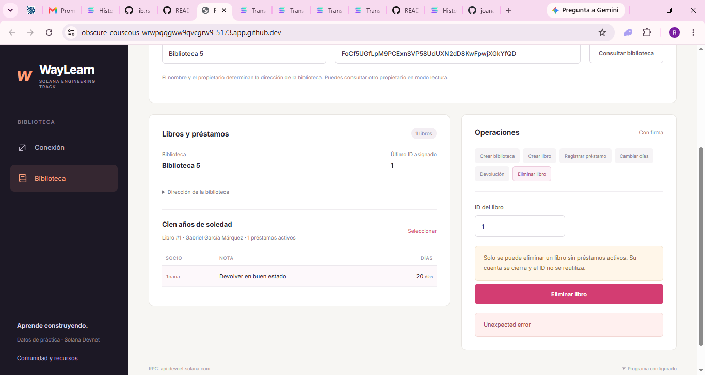

# Biblioteca en Solana: libros y préstamos con PDAs

Proyecto final del **Solana Engineering Track (Advanced / Etapa 2) – WayLearn**.

| | |
|---|---|
| **Autora** | Ramirez Peguero Joana Arizbeth |
| **Correo de registro** | 2524260108@e.uttecamac.edu.mx |
| **Ruta elegida** | Proyecto propio (adaptado del template Registro-Ventas) |
| **Red** | Solana Devnet |
| **Program ID** | `5gC5fZfCMsjUWvnDJbSG7F5BCqxrvUvsNTxwAbj5onA6` |
| **Explorer** | https://explorer.solana.com/address/5gC5fZfCMsjUWvnDJbSG7F5BCqxrvUvsNTxwAbj5onA6?cluster=devnet |

## Propósito

Programa de Solana (Anchor) que administra una biblioteca: la dueña de la biblioteca registra **libros** y, por cada libro, los **préstamos** a sus socios. Un frontend con wallet (Phantom) permite crear, consultar, modificar y cerrar cada cuenta desde el navegador.

El proyecto parte de los templates del curso (`Registro-Ventas-Solana-PDA` y `Registro-Ventas-Solana-App`), pero modela un dominio distinto con sus propias reglas.

## Aporte propio

1. **Dominio nuevo:** Biblioteca → Libro → Préstamo, en lugar de Registro → Cliente → Venta.
2. **Regla de negocio en el programa:** un libro **no se puede eliminar mientras tenga préstamos activos** (error `LibroConPrestamos`). Así no quedan préstamos huérfanos.
3. **Id automático para los libros:** el programa asigna el id con un contador (`id_counter`) guardado en la biblioteca. Los ids no se reutilizan al eliminar.
4. **Préstamo identificado por texto:** la PDA se deriva con el `socio`, por lo que un socio no puede tener dos préstamos del mismo libro a la vez.
5. **Operación de modificación:** `cambiar_dias` (renovar un préstamo) registra con `msg!` el valor anterior y el nuevo.
6. **Límite controlado:** cada lista admite máximo 10 elementos y el programa lo valida antes de guardar (`LimiteAlcanzado`).

## Reglas de seguridad aplicadas en el programa

| Regla | Cómo se aplica |
|---|---|
| **Autoridad** | `has_one = owner @ Errores::NoOwner` en la biblioteca en todas las instrucciones, excepto en la que crea la raíz |
| **Pertenencia** | Cada cuenta se deriva de su padre con `seeds` + `bump`, y cada contexto incluye la cadena completa de cuentas |
| **Cierre de cuentas** | `close = owner` en `devolver_prestamo` y `eliminar_libro`; la renta regresa a la wallet |
| **Cierre condicionado** | `eliminar_libro` exige `prestamos.is_empty()` |
| **Vectores consistentes** | Al cerrar una cuenta se quita su PDA del vector del padre y se actualiza el contador |

## Estructura de cuentas (PDAs)

```
Biblioteca <- [b"biblioteca", nombre_biblioteca, owner]   raíz
 └─ Libro <- [b"libro", biblioteca, id_libro (u16, little-endian)]
     └─ Prestamo <- [b"prestamo", libro, socio]
```

| Cuenta | Campos |
|---|---|
| `Biblioteca` | `owner`, `nombre_biblioteca` (30), `libros` (Vec, máx. 10), `id_counter` (u16) |
| `Libro` | `id_libro` (u16), `titulo` (40), `autor` (30), `total_prestamos` (u16), `prestamos` (Vec, máx. 10) |
| `Prestamo` | `socio` (20), `nota` (50), `dias` (u8) |

Los textos se miden en **bytes**: un acento ocupa más de un byte.

## Instrucciones

| Instrucción | Argumentos (en orden) | Qué hace |
|---|---|---|
| `crear_biblioteca` | `nombre_biblioteca` | Crea la raíz |
| `crear_libro` | `nombre_biblioteca`, `titulo`, `autor` | Crea un libro con id automático y guarda su PDA en `libros` |
| `registrar_prestamo` | `nombre_biblioteca`, `id_libro`, `socio`, `nota`, `dias` | Crea el préstamo, lo guarda en `prestamos` y suma 1 a `total_prestamos` |
| `cambiar_dias` | `nombre_biblioteca`, `id_libro`, `socio`, `nuevos_dias` | Modifica los días del préstamo |
| `devolver_prestamo` | `nombre_biblioteca`, `id_libro`, `socio` | Quita el préstamo del historial, resta 1 al contador y cierra la cuenta |
| `eliminar_libro` | `nombre_biblioteca`, `id_libro` | Solo si no tiene préstamos: lo quita de `libros` y cierra la cuenta |

Errores propios: `NoOwner`, `LimiteAlcanzado`, `LibroNoExiste`, `PrestamoNoExiste`, `LibroConPrestamos`.

## Estructura del repositorio


```
programa/lib.rs        Programa Anchor (Rust)
idl.json               IDL exportado del programa desplegado
clients/js/            Cliente generado a partir del IDL
src/                   Frontend (React + Vite)
evidencias/            Capturas de las pruebas
README.md
```

## Cómo ejecutarlo

Requisitos: Node.js (LTS reciente), una wallet de navegador (Phantom) en **Devnet** con SOL de prueba.

```bash
npm install
npm run configurar:idl -- ./idl.json --program-id 5gC5fZfCMsjUWvnDJbSG7F5BCqxrvUvsNTxwAbj5onA6
npm run typecheck
npm run dev
```

Abre la URL que muestra la terminal (normalmente `http://localhost:5173`), conecta Phantom en Devnet y usa la misma wallet con la que creaste la biblioteca: es la `owner` y la única con permiso de escritura.

También se puede ejecutar en GitHub Codespaces con los mismos comandos.

## Cómo probarlo

1. Conecta la wallet y crea una biblioteca.
2. Crea un libro.
3. Registra un préstamo para ese libro.
4. Comprueba que las tablas muestran los datos leídos de la cadena.
5. Cambia los `dias` del préstamo.
6. Intenta eliminar el libro **con** préstamos: el programa lo rechaza (`LibroConPrestamos`).
7. Devuelve el préstamo (se cierra la cuenta).
8. Elimina el libro, ahora sin préstamos.
9. Con **otra wallet**, intenta modificar la biblioteca: el programa rechaza (`NoOwner`).

## Evidencias

Capturas en la carpeta `evidencias/`. Transacciones en Devnet:

| # | Prueba | Transacción / captura |
|---|---|---|
| 1 | Programa desplegado | [Ver en Explorer](https://explorer.solana.com/address/5gC5fZfCMsjUWvnDJbSG7F5BCqxrvUvsNTxwAbj5onA6?cluster=devnet) |
| 2 | Crear biblioteca | https://explorer.solana.com/tx/2n7go7CJtQNjBVX3nbA3STd8ronEB8ausoToT37uuKNjX2j6fEHqreCkZwy3x43gCBF6oSn28FvTCGQZzAmgwefU?cluster=devnet |
| 3 | Crear libro | https://explorer.solana.com/tx/uDhMryUBG5T6sZrUHNnPhcw3RzxNStTAAq6eYVj5CU3bL8ySW1FSp7MFqKPiuTKrnfzsso1eXepLLaJspNxZBdf?cluster=devnet |
| 4 | Registrar préstamo | https://explorer.solana.com/tx/5CjiwkWQk2Pmp1Xu7nwBczRMQ7HUy6byiwT31ee7BZhyixbEpjWj8nTexcrP9wJEJmSbLjL8oqnezVfY5ziY6BcP?cluster=devnet |
| 5 | Cambiar días | https://explorer.solana.com/tx/DhW5LSYHc5z86iEi5aXS54m117UkKrjonM2Tssrje7sNCpNuoHpTh2LyeuVKqPPHBUMrXBCNMnGJoeZ44qe8NBe?cluster=devnet |
| 6 | Eliminar libro con préstamos |  |
| 7 | Devolver préstamo  | https://explorer.solana.com/tx/5QjU7LVJy8EyB4e1LAKYWSRZCh5cV4nH6DtNT8SQxU4JvxciLUehFhac81v6Myg4z9mM3HSK8fETcdthNVPdqh2o?cluster=devnet |
| 8 | Eliminar libro sin préstamos | https://explorer.solana.com/tx/4JLmM5qyVQ4yZuRccrqgDW5gey1mPih1nezT5WNGvoKVJpGAsKeNdXeZwV5nXsmoz5jK5abi6RXC3EVJHyfgH9Yp?cluster=devnet |

## Notas
El programa se compiló y desplegó con Anchor en Codespaces en Github

## Uso de herramientas de IA

Usé los prompts del curso con un asistente de IA para adaptar el programa y el frontend al dominio de la biblioteca. Revisé el código, desplegué el programa y ejecuté las pruebas descritas arriba, y puedo explicar el funcionamiento de cada instrucción.
